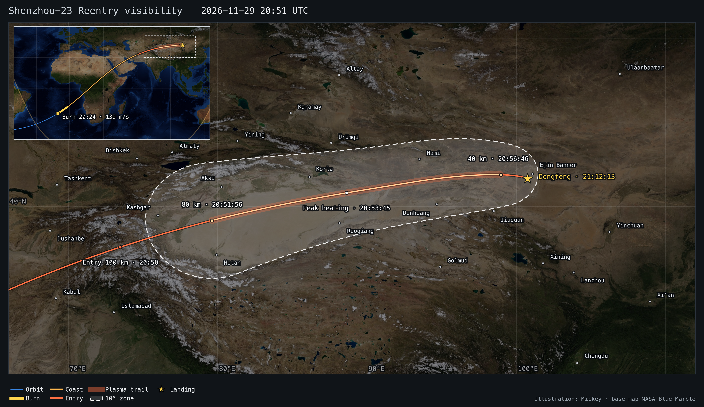
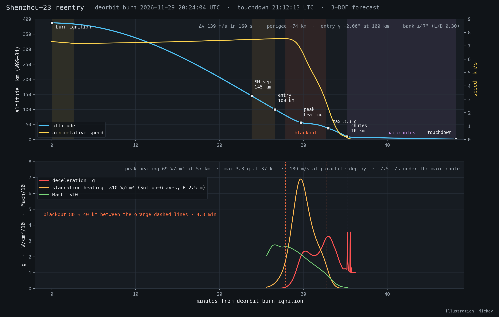
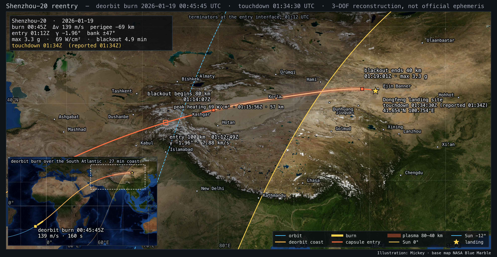
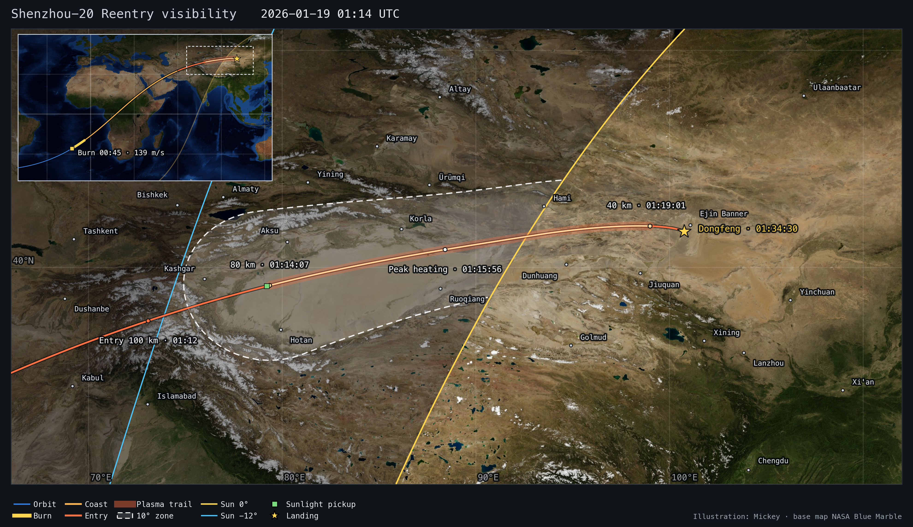
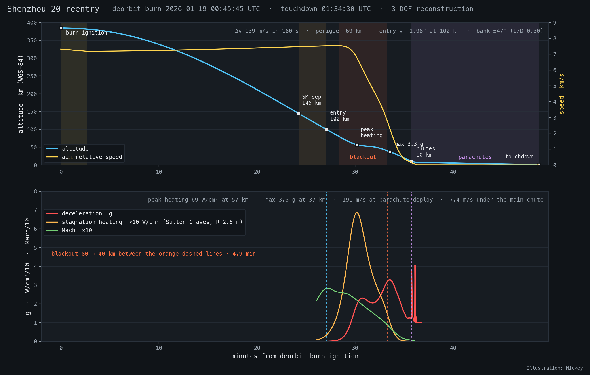

# Shenzhou reentry

Physical model of a Shenzhou return from the China Space Station — deorbit burn, coast, service-module separation,
lifting capsule entry, plasma blackout, parachutes and touchdown at the Dongfeng landing site — with an interactive 3D
page. Two uses so far:

- **Forecast: Shenzhou-23, 29 November 2026 (UTC).** Made on 11 November from the station's published orbit after
  the 13 November reboost. The pass of 29 November crosses the site at 2.4 km: touchdown 21:12 UTC (05:12 Beijing time
  on 30 November), at night. See [the forecast](#shenzhou-23-forecast-29-november-2026).
- **Reconstruction: the uncrewed return of Shenzhou-20 on 19 January 2026** (the spacecraft with the cracked window),
  landed 01:34 UTC at 41.654 N 100.754 E.




**Interactive page:** <https://exoplanet5.github.io/shenzhou-reentry/> (GitHub Pages from `docs/`), or served locally
(see below). **Methodology and results write-up:** <https://exoplanet5.github.io/shenzhou-reentry/model.html>
(`docs/model.html`). The page is the launch-page template (`~/launch/launch-page-template`) with its reentry fields:
playback from the orbit before the burn, the capsule cartoon through each phase, the self-luminous plasma trail, the
landing site, a status panel with air speed, Mach, load and range to the site, a summary table, sky charts for any
city or ground point, and the Earth-fixed or inertial frame.

These are models built from public reports and published Shenzhou return-sequence figures, **not official ephemeris
and not an official schedule**.

## What is here

| path | content |
|---|---|
| `deorbit_fit.py`, `SZ-20_reentry_trajectory.csv` | the original Keplerian fit and its SGP4 arc (kept unchanged; audited below) |
| `model/shenzhou_reentry.py` | 3-DOF reentry model and solver (WGS-84, J2, rotating Earth, NRLMSIS 2.1 / US76, capsule lift and drag, bank steering, parachutes); reconstruction and prediction modes |
| `model/atmo.py`, `model/us76.py` | atmosphere models (`us76.py` is the Starship IFT-14 module) |
| `model/missions/sz20.json` | all inputs for Shenzhou-20: element set, reported times and site, published sequence heights, vehicle data, with sources |
| `model/missions/sz23-1129.json` | the Shenzhou-23 forecast, written by `tools/css_orbit.py` |
| `model/elements/css_supgp_2026-11-11.*` | CelesTrak supplemental elements of the station (NORAD 48274), as fetched on 11 Nov 2026 |
| `model/atmo_msis_<id>.json` | cached NRLMSIS 2.1 columns (so reruns do not need pymsis) |
| `sz20_gp_history.json` | Space-Track element sets of SZ-20 (NORAD 63632), 14–19 Jan 2026 |
| `tools/css_orbit.py` | station orbit forecast from the supplemental elements, passes over the site, forecast mission files |
| `out/sz23_orbit_forecast.json` | the fitted element set, fit residuals, drag sensitivity and every pass near the site |
| `out/<id>_solution.json`, `out/<id>_trajectory.csv` | solved parameters, events, diagnostics; 1 s trajectory (UTC, lon/lat/WGS-84 height, speeds, Mach, load, heating, phase) |
| `out/sz20_solution_0045.json`, `_0046`, `_us76` (+ CSVs) | Shenzhou-20 sensitivity runs: ignition 00:45:00 / 00:46:30, US76 atmosphere |
| `out/<id>_visibility.png` (+ `.json`), `out/<id>_profile.png`, `out/sz20_map.png` | figures; the JSON holds the map's assumptions |
| `tools/export_mission.py` | mission JSON for the page in the template's format (`out/web/<id>.json`, not kept in git: tracks, events, capsule cartoon, DE440s Sun and Moon tables, element sets) |
| `tools/build_page.py` | builds `docs/` from the launch-page template and registers every solved mission |
| `tools/plot_visibility.py`, `tools/plot_map.py`, `tools/plot_profile.py` | figures |
| `docs/` | the 3D page: template code, mission data in `docs/data/`, and this project's `docs/model.html` and `docs/img/` |
| `tests/` | mission tests (`node --test`), headless-Chrome test, screenshot helper |

## Shenzhou-23 forecast, 29 November 2026

Made on 11 November 2026. Shenzhou-24 is expected to launch around 25 November; Shenzhou-23, docked since 24 May,
then returns with two of its crew and the visiting astronaut. The date is not announced. (The spacecraft that lands is
Shenzhou-23, during the Shenzhou-24 handover.)

**Orbit.** CelesTrak fits supplemental elements for the station to the ephemeris CMSA publishes, in 6-hour segments;
that ephemeris includes planned manoeuvres. The set of 11 November has 28 segments to 18 November 00:00 UTC and shows
the reboost in the segment of 13 November 06:00–12:00 UTC (mean motion 15.6173 → 15.6058 rev/day, about +1.9 km).
Each segment is valid forward from its epoch. `tools/css_orbit.py` samples the 18 segments after the reboost and fits
one SGP4 set (mean elements and B*) to them: 0.6 km RMS along track over 4.5 days, B* 2.0e-4. That set is propagated
12 days.

```
1 69180U 26113A   26321.75000000  .00000000  00000-0  19968-3 0  9999
2 69180  41.4679 108.7708 0007680 292.3004 344.7832 15.60744506    08
```

**Passes.** The site lies at the top of the ground track, so the track crosses it heading east. The pass of
29 November misses the Shenzhou-20 landing point by 2.4 km — the Shenzhou-20 pass itself missed by 2.3 km — so this
is the pass the reboost phases for. The other passes of that day miss by 260 km or more.

**Descent.** The Shenzhou-20 reconstruction moved onto this pass: the same burn (138.8 m/s in 160 s) and bank
magnitude (47°); the ignition time and the bank reversal are solved for the aim point; the landing time is an output.
The ignition is then put on a whole second, which moves the bank by up to 0.2°.

| UTC date | pass over the site | track south of site | ignition | entry 100 km | plasma 80–40 km | touchdown | Beijing time | Sun at site |
|---|---|---|---|---|---|---|---|---|
| 29 Nov | 20:56:46 | 2.4 km | 20:24:04 | 20:50:40 | 20:51:56 – 20:56:46 | 21:12:13 | 30 Nov 05:12 | −38° |

A night landing. Entry angle −2.00° at 100 km, 3.3 g, peak heating 69 W/cm², blackout 4.8 min.
The capsule is in the Earth's shadow throughout, so only the plasma trail's own light shows, from about 79.5° E over
the western Tarim basin to 99° E. The map's 10° zone (sea-level sites that have some point of the 80–40 km trail at
10° or more, Sun below the horizon) covers 1.27 million km². There is no sunlight pickup to mark.

**Uncertainty.**

- The day and the pass are CMSA's choice; the orbit only says which pass lines up.
- Drag: ±30 % over the propagation moves the pass by ±45 s. These are the page's T0 presets.
- A further station manoeuvre before the return moves the pass by minutes. The published ephemeris ends on
  18 November: fetch it again nearer the date and rerun (see Reproduce).
- The burn and bank are Shenzhou-20's. A different entry angle changes the burn-to-landing time by tens of seconds.
- After undocking the spacecraft leaves the station orbit by a few km; the forecast uses the station's.
- The aim point is the Shenzhou-20 landing point. Winds are not modeled.

## Audit of the original model (`deorbit_fit.py`, `SZ-20_reentry_trajectory.csv`)

**Inputs.** The CSS element set with epoch 2026-01-17 18:13 UTC (its line 2 is byte-identical to the SZ-20 set of
the same epoch, which is fine: docked objects share elements); a burn time of 00:48:00 UTC; and three target
constraints relative to the burn: 145 km at +21 min, 80 km at +25 min and a flight-path angle of −1.6° at 120 km.

**Method.** SGP4 gives the position at the burn time; a two-body ellipse with the same position (descending branch)
is fitted in (a, e) by least squares to the three constraints, with the entry-angle weight increased until it is met
to 0.01°. The remaining elements come from the SGP4 state; a TLE is written with B* = 0; the CSV is SGP4 of that TLE
(verified: identical to the metre). Assumptions: impulsive burn, two-body motion (no J2), spherical Earth of radius
6378.135 km, no atmosphere, and osculating elements used as TLE mean elements.

**Findings.**

1. **The delta-v is wrong by a factor of 60.** `rv_from_coe` uses the transposed rotation about the x axis
   (`R1 = [[1,0,0],[0,c,s],[0,-s,c]]`), so the reconstructed state sits 4,759 km from the burn point and the printed
   delta-v is 8,590 m/s, 55° off retrograde. With the standard rotation the position matches to a metre and the
   delta-v of the fitted ellipse is 142.7 m/s, 36.9° off pure retrograde. The large angle is a second problem: the
   "same position, descending branch" constraint near apogee forces a radial velocity component, so the fitted
   ellipse is not what a retrograde burn produces. A tangential burn to the same semi-major axis would be 108 m/s.
2. **Three constraints, two unknowns.** The fit cannot meet them: it reaches 138.8 km at +21 min (target 145) and
   87.1 km at +25 min (target 80) while hitting the angle. The two height-time constraints themselves imply a
   vertical speed between 145 and 80 km that no single Keplerian arc through the burn point provides.
3. **No atmosphere.** The SGP4 arc keeps 7.9 km/s down to 37.8 km at 101.2 E. A capsule is at 3.1 km/s at 40 km and
   under its drogue at 10 km; the published Shenzhou sequence has the capsule at ~200 m/s at 10 km. The track below
   about 80 km is therefore not a trajectory, and the arc's perigee of −2.7 km is a bookkeeping value.
4. **Entry angle reference.** The −1.6° was applied at 120 km, where the fitted ellipse gives −1.52° at 100 km. The
   published 1.5–1.7° figure does not state its reference height; the reconstruction below shows that the reported
   timeline forces about −2.0°.
5. **What was right.** The geometry: the ground track passes within 0.1° of the landing site, and the 100 km point
   (01:12:00 at 70.4 E 36.7 N) is within a minute and 300 km of the reconstruction (01:12:49 at 73.2 E 37.6 N).
   The CSS/SZ-20 orbit, the burn-side geometry over the South Atlantic and the entry heading over Central Asia all
   carry over.

## The reconstruction

**Dynamics.** 3-DOF point mass integrated in the Earth-fixed rotating frame (DOP853, 1e-9 tolerances): J2 gravity,
Coriolis and centrifugal terms, WGS-84 ellipsoid for heights, a co-rotating atmosphere (no wind). The state before
the burn is SGP4 from SZ-20's own Space-Track element set (epoch 00:56 UTC on 19 Jan, the last set consistent with the
pre-burn orbit), rotated TEME → ECEF with GMST.

**Deorbit burn.** Constant acceleration, retrograde along the inertial velocity, 160 s (published 150–180 s). The
delta-v is solved. With the return and propulsion modules at about 5.7 t the solved 139 m/s implies 5.0 kN, i.e. two
of the four 2.5 kN main engines.

**Return module.** 3,240 kg, 2.52 m diameter (S = 4.99 m²), hypersonic C_D 1.30 and L/D 0.30 (Soyuz-class blunt
capsule at its trim angle; ballistic coefficient ~500 kg/m²), with a supersonic drag rise and a subsonic drop and
the trim lift fading through transonic flight. The lift vector is banked by a constant angle with one reversal
(solved), a proxy for the roll-modulated guidance. Lift is only applied after service-module separation at 145 km.

**Atmosphere.** NRLMSIS 2.1 column above the landing site at the landing epoch (fixed F10.7 = 150, Ap = 10): a January
mid-latitude column is 15–30 % thinner than US76 between 60 and 140 km. US76 is available for comparison (`--atmo
us76`).

**Parachutes.** Pilot/drogue at 10 km (drogue 24 m², C_D 0.8, 2 s inflation), main at 8 km (C_D·S = 920 m², reefed
35 % for 8 s), heat shield (300 kg) jettisoned at 6 km, touchdown at the 1.0 km terrain height. The main's drag area is
set so the descent rate is 7.5 m/s at the site, matching the published 7–8 m/s; the retro-rocket pulse at 1 m is not
modeled.

**Heating.** Sutton–Graves stagnation-point indicator with a 2.5 m nose radius; it is a comparison number, not a
thermal-protection analysis.

**Solver.** For a given burn ignition time the free parameters delta-v, bank angle and reversal time are solved by
least squares so that the capsule touches down at the reported point and the reported minute (01:34:30 ± 30 s). The
ignition time is set from the reported orbital-module separation minute (08:44 Beijing = 00:44 UTC) plus the ~60–90 s
second attitude slew: nominal 00:45:45, with 00:45:00 and 00:46:30 as bounds. The entry angle, loads, heating and
blackout duration are outputs.

### Shenzhou-20 result (nominal, ignition 00:45:45 UTC)

| event | model (UTC) | T+ | reported / published |
|---|---|---|---|
| orbital module separation | — | −1:45 | 00:44 (CCTV) |
| deorbit burn ignition | 00:45:45 | 0:00 | after the second slew |
| burn cutoff | 00:48:25 | 2:40 | 150–180 s burn |
| service module separation, 145 km | 01:09:58 | 24:14 | 145 km |
| trim attitude, 120 km | 01:11:33 | 25:48 | 120 km |
| entry interface, 100 km, 7.88 km/s | 01:12:49 | 27:04 | 100 km, ~7 km/s |
| blackout begins, 80 km | 01:14:06 | 28:22 | 80 km |
| peak heating 69 W/cm², 57 km | 01:15:56 | 30:11 | |
| blackout ends, 40 km | 01:19:01 | 33:16 | 40 km |
| maximum deceleration 3.3 g, 37 km | 01:19:16 | 33:32 | 4–5 g quoted for crewed returns |
| Mach 1 | 01:20:59 | 35:14 | |
| parachute cover off, 10 km, 191 m/s | 01:21:30 | 35:45 | 10 km, ~200 m/s |
| main parachute, 8 km, 72 m/s | 01:21:51 | 36:06 | drogue slows to 60–90 m/s |
| heat shield jettison, 6 km | 01:24:41 | 38:56 | 6 km |
| touchdown, 7.4 m/s before retro-rockets | 01:34:30 | 48:45 | 01:34, 7–8 m/s under the main |

Deorbit delta-v 138.8 m/s, perigee −69 km, entry flight-path angle −1.96° at 100 km (−2.00° at 120 km, inertial;
−2.05° relative to the air), bank ±47° reversing 4.2 min after entry, blackout 4.9 min (published "4–6 min"),
landing point matched to the metre by construction. The plasma phase ran from 79.4 E over the western Tarim basin between Kashgar and Aksu
to 99.0 E in the Gobi west of Ejin Banner, 09:14–09:19 Beijing time, with the Sun rising along the track (−9° at blackout start,
−3° at peak heating, +4° at blackout end): a dawn fireball over Xinjiang in nautical-to-civil twilight, visible from
Aksu, Korla or Hami had the sky been clear.





### Sensitivity

| ignition (UTC) · atmosphere | Δv m/s | perigee km | γ at 100 km | γ at 120 km | bank ° | max g | peak W/cm² | blackout min | burn→entry min | entry→chute min | thrust kN |
|---|---|---|---|---|---|---|---|---|---|---|---|
| 00:45:00 · MSIS | 135.0 | −58 | −1.89 | −1.94 | 46 | 3.2 | 67 | 5.1 | 27.6 | 8.9 | 4.8 |
| **00:45:45 · MSIS (nominal)** | **138.8** | **−69** | **−1.96** | **−2.00** | **47** | **3.3** | **69** | **4.9** | **27.1** | **8.7** | **5.0** |
| 00:46:30 · MSIS | 142.9 | −82 | −2.03 | −2.07 | 48 | 3.3 | 71 | 4.7 | 26.6 | 8.4 | 5.1 |
| 00:45:45 · US76 | 138.0 | −66 | −1.94 | −1.99 | 49 | 3.3 | 67 | 4.8 | 27.2 | 8.6 | 5.0 |

The ignition minute moves the delta-v by ±4 m/s and the entry angle by ±0.07°; the atmosphere model moves the bank
angle by 2°. All cases land at the reported point and minute. The quoted 1.5–1.7° entry angle cannot be reconciled
with the 50 minutes from orbital-module separation to touchdown: a −1.6° entry (120 km) needs about 3 minutes more
between the burn and the landing than the reports allow, so either the angle refers to another convention or the
published figure is rounded.

**Limitations.** No winds (the 13 min parachute descent drifts with the wind in reality); no attitude dynamics; a
single bank reversal instead of the real guidance; capsule coefficients are literature values for Soyuz-class
capsules, not Shenzhou wind-tunnel data; the orbital-module separation and landing times are known to the minute
only; the landing coordinates are from Wikipedia, not CMSA; the terrain height is an assumption (±100 m ≈ ±13 s).

## Interactive page

```sh
python3 tools/serve.py             # http://127.0.0.1:8770/
```

- The mission menu holds the Shenzhou-23 forecast and the Shenzhou-20 reconstruction; it opens on the forecast. Changing
  the mission keeps the camera, frame and MET.
- T± is time from deorbit-burn ignition; the slider runs from one orbit before the burn to touchdown. Space toggles
  playback, arrows seek 10 s (300 s with Shift). Click the track or a timeline row to jump; hover the track to inspect.
- T0 (burn ignition) can be shifted: the Earth-fixed track stays and only the Sun moves. Forecasts have three
  presets, the model time and the ±30 % drag bounds; the reconstruction has "Actual".
- The cartoon follows the sequence: three modules in orbit, two for the retro burn (engine first), the capsule alone
  behind its heat shield, in its plasma sheath, scorched, then upright under the drogue and the main parachute.
- Click any city or anywhere on the globe for its sky chart. The plasma phase is drawn as a self-luminous orange arc
  and counted as visible in a dark sky whether or not the Sun reaches it. The green dashed 10° circle follows the capsule.
- The status panel shows phase, altitude, inertial and air speed, Mach and load, illumination, ground lighting and
  the range and time to the landing site; "Forecast summary" or "Reconstruction vs reported" gives the solution.
- ECEF / GCRS in the title bar switches between ground tracks over the turning Earth and a fixed orbit with the Earth
  turning under it. Layers: terminators, labels, ground track, graticule, cities, city lights, borders, stars with Sun
  and Moon.
- **Drag** turns the globe; **right-drag**, Ctrl/Shift-drag or **two fingers** tilt and rotate about the view point;
  scroll or pinch zooms. The camera presets reset to a north-up vertical view.
- URL parameters restore a view, e.g. `?mission=sz20&met=1850&cam=92,40.5,1.5&sky=Jiuquan`; `cam` is
  `lon,lat,dist,heading,tilt` (the last two optional), `frame=gcrs` the inertial view.

The page code is the template's and is not edited here: `tools/build_page.py --upgrade` rebuilds `docs/` from the
current template and carries over `docs/model.html` and `docs/img/`. The reentry features are optional mission
fields of the template (`meta.met_min`, `meta.landing`, `meta.plasma_intervals`, the `service` / `capsule` /
`orbital` stack kinds, `meta.summary`, track arrays `vrel`, `vin`, `mach`, `g`), described under "Reentry missions"
in the template's `PROFILE_FORMAT.md`. `tools/export_mission.py --id <id> --check` verifies that a published mission
file is a reproducible build of the model outputs.

## Reproduce

Python 3.13 environment with numpy, scipy, sgp4, skyfield, pymsis (only for a fresh MSIS column), matplotlib, pillow;
the shared `~/JPLDE/de440s.bsp` for the Sun and Moon tables; Node 22+ and Chrome for the tests; the launch-page skill
and template for the page.

```sh
P=~/.venvs/astro313/bin/python
# Shenzhou-20 reconstruction
$P model/shenzhou_reentry.py --solve                          # nominal (about 3 min); --tign 00:46:30 --tag _0046 for variants
$P model/shenzhou_reentry.py --solve --atmo us76 --tag _us76
# Shenzhou-23 forecast: fetch the current elements, forecast the orbit, solve
curl -o model/elements/css_supgp_$(date -u +%F).tle 'https://celestrak.org/NORAD/elements/supplemental/sup-gp.php?CATNR=48274&FORMAT=tle'
$P tools/css_orbit.py --supgp model/elements/css_supgp_2026-11-11.tle --dates 2026-11-29
$P model/shenzhou_reentry.py --mission model/missions/sz23-1129.json --solve     # about 2 min
# page and figures
$P tools/build_page.py                                        # export every solved mission, register it in docs/ (--upgrade: new template)
for id in sz23-1129 sz20; do $P tools/plot_visibility.py --id $id; $P tools/plot_profile.py --id $id; done
$P tools/plot_map.py                                          # Shenzhou-20 entry-corridor map
npm test                                                      # mission tests
python3 tools/serve.py & npm run test:browser                 # headless-Chrome test, screenshots in .test-artifacts/
$P ~/.claude/skills/launch-page/scripts/check_page.py .       # the template's performance budgets
```

To add another return, copy `model/missions/sz20.json` for a reconstruction (element set from `st.py gp <norad>
--from … --lines`, reported times and site) or run `tools/css_orbit.py` with other dates, `--id` and `--name` for a
forecast; then solve and run `tools/build_page.py`. Its `DEFAULT` sets the mission the page opens on.

## Sources

CMSA / Xinhua / CCTV reports of 19 Jan 2026 (undocking 00:23 Beijing, orbital-module separation 08:44, landing 09:34
Beijing at Dongfeng); the Wikipedia Shenzhou 20 article for the landing coordinates; CCTV / Xinhua / CASC
return-sequence explainers (Shenzhou-14, -16, -20) for the sequence heights, burn duration, blackout, parachute and
retro-rocket figures; astronautix.com, braeunig.us and China Space Report for the vehicle (masses, dimensions, L/D,
engines, parachute areas); Space-Track for the Shenzhou-20 element sets; CelesTrak supplemental GP data (source CSS-E,
from the CMSA ephemeris) for the station orbit of the forecast; GCAT (J. McDowell) for the Shenzhou-23 launch and
catalog number; press reports of the expected Shenzhou-24 launch date. Starship IFT-14 (`~/sda/starship-ITF-14`) supplied the
3-DOF entry framework, the US76 module and the map style; the launch-page template (`~/launch/launch-page-template`,
grown from the CZ-6A viewer) the 3D page.

## Credits

Illustration: Mickey. Base map NASA Blue Marble Next Generation and Black Marble. Boundaries: Natural Earth. three.js
(MIT, `docs/vendor/three/LICENSE`); star catalog and Milky Way from d3-celestial (BSD-3). Viewer code adapted from
[CZ-6A](https://github.com/exoplanet5/CZ-6A) and [Starship IFT-14](https://github.com/exoplanet5/Starship-IFT14).
Code: MIT, see `LICENSE`.
